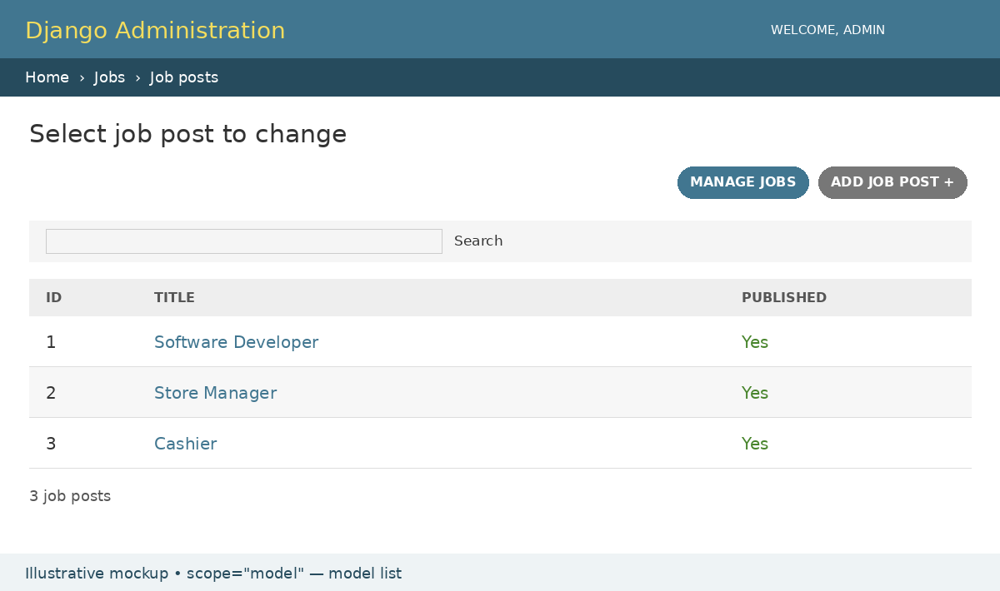
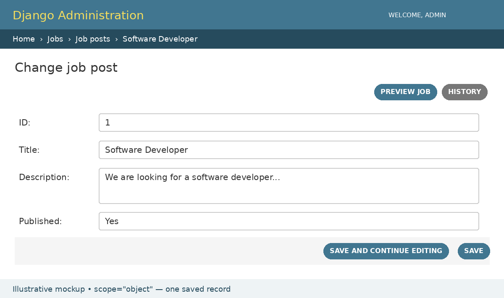
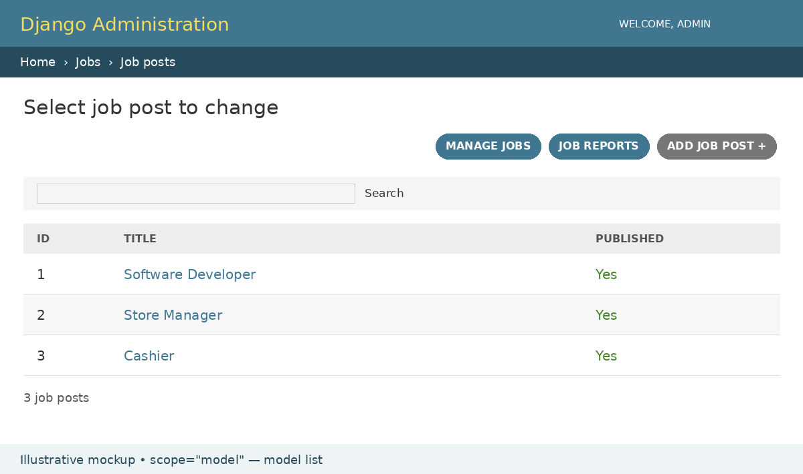
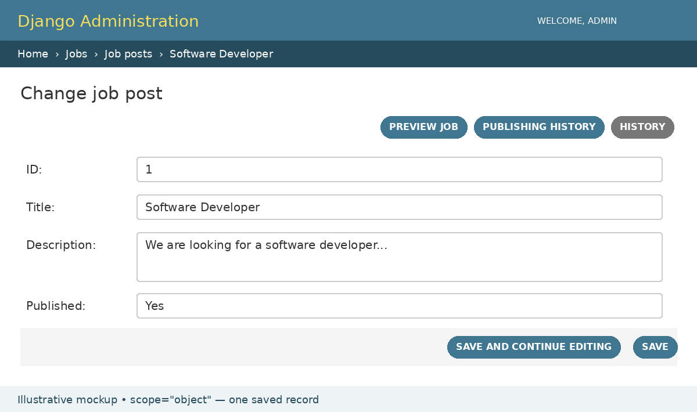

# Understanding `scope` in django-admin-management-fdg

**Developer guide | Version 1.0.0**

This guide explains the two supported scopes, how to configure them, where buttons appear, how views and templates receive context, and how to test the behavior. It expands the original explanation and checks the configuration and routing examples against the supplied 1.0.0 source archive. The figures are static illustrative recreations of the original interactive previews, not screenshots from a running application.

## 1. What does `scope` mean?

`scope` determines where a custom management button appears and whether its page is associated with a model as a whole or with an individual saved object.

There are two supported values:

| Value | Button location | Management target |
| --- | --- | --- |
| `"model"` | Model list page (`changelist`) | Model-level workflow; may operate on multiple records |
| `"object"` | Individual object change page (`change_form`) | One specific saved record |

The default is `scope="model"`. These are the only two accepted values in this release; invalid values raise `ValueError`.

A Django **model** is a Python class describing a type of data (for example, `JobPost`). A Django **object** is an instance of that model (for example, the job with primary key 1). The scope is not a permission, a database query, or a restriction on what your business logic can do.

## 2. Model scope

Use model scope when the workflow is not tied to a particular record. (e.g. the management page is related to the entire model rather than a specific database record).

```python
ManagementPage(
    name="manage_jobs",
    label="Manage Jobs",
    icon="💼",
    scope="model",
    template_name="job/manage_jobs.html",
    permission="job.can_upload_job",
)
```

The custom button appears on the model list page and is associated with the entire JobPost model.



*Figure 1. Manage Jobs appears beside the original Add Job Post button. The blue button is illustrative; the package default style may differ.*

Example URLs, assuming the standard `/admin/` mount and the `job.JobPost` model:

```text
/admin/job/jobpost/
/admin/job/jobpost/manage/manage_jobs/
```

There is no object ID in the managed page URL. A managed view receives `request.fdg_management_object = None`; the template receives `management_object = None`. The package does not automatically query every record. The developer decides which data to retrieve and what operations to permit.

Typical use cases:

- Manage all job postings.
- Upload multiple flyer images.
- Delete expired notifications.
- Run a protected server-side publishing job or management command.
- Generate reports or model-wide dashboards.
- Import/export data or perform bulk operations.

Our United Supermarket applications are examples of model-level workflows:

| Application | Button | Scope |
| --- | --- | --- |
| `flyer_manifest` | Staff Upload Page | `model` |
| `job` | Manage Jobs | `model` |
| `site_notifications` | Manage Notifications | `model` |

These describe the existing workflows; they do not imply the original apps already use the package.

## 3. Object scope

Use object scope for a workflow associated with one saved record.

```python
ManagementPage(
    name="preview_job",
    label="Preview Job",
    icon="👁️",
    scope="object",
    template_name="job/preview_job.html",
    permission="job.view_jobpost",
)
```



*Figure 2. Preview Job appears alongside History when editing a saved JobPost. No object-specific button appears on the Add form before the record is saved.*

Example URLs (verified against `get_urls()` in 1.0.0):

```text
/admin/job/jobpost/1/change/
/admin/job/jobpost/manage-object/1/preview_job/
```

The managed route contains an object identifier. The mixin retrieves the object via `ModelAdmin.get_object()` using Django Admin's unquoting convention. Missing objects return HTTP 404. The resolved object is available in the custom view and template.

### Accessing the current object in Python

```python
def preview_job(request):
    job = request.fdg_management_object
    print(job.pk)
    print(job.title)
```

The snippet demonstrates object access; it is not a complete Django view because it does not return an HTTP response. A complete custom view is shown below.

### Accessing the object in a template

```django



    <h1>{{ management_object.title }}</h1>
    <p>Job ID: {{ management_object.pk }}</p>
    <p>{{ management_object.description }}</p>

```

Save this as `templates/job/preview_job.html`. This example assumes `JobPost` has `title` and `description` fields; adapt the fields to your real model.

You do not need to manually retrieve this object by primary key. Typical use cases include previewing a job, viewing an employee's training results, viewing a customer's order history, emailing about an appointment, generating an invoice PDF, viewing activity history, managing product images, and duplicating a record. Operations that modify state must use protected non-GET endpoints.

## 4. Mixing both scopes in a ModelAdmin

Both scopes can be used in one `management_pages` configuration. The mixin must precede `admin.ModelAdmin` in the inheritance list.

```python
from django.contrib import admin
from django_admin_management_fdg import ManagementAdminMixin, ManagementPage
from .models import JobPost


@admin.register(JobPost)
class JobPostAdmin(ManagementAdminMixin, admin.ModelAdmin):
    management_pages = (
        # Model-level buttons
        ManagementPage(
            name="manage_jobs",
            label="Manage Jobs",
            scope="model",
            template_name="job/manage_jobs.html",
            permission="job.change_jobpost",
        ),
        ManagementPage(
            name="reports",
            label="Job Reports",
            scope="model",
            template_name="job/reports.html",
            permission="job.view_jobpost",
        ),
        # Object-level buttons
        ManagementPage(
            name="preview_job",
            label="Preview Job",
            scope="object",
            template_name="job/preview_job.html",
            permission="job.view_jobpost",
        ),
        ManagementPage(
            name="job_history",
            label="Publishing History",
            scope="object",
            template_name="job/history.html",
            permission="job.view_jobpost",
        ),
    )
```



*Figure 3. Model list: only Manage Jobs and Job Reports are displayed, subject to permissions.*



*Figure 4. Object change page: only Preview Job and Publishing History are displayed, subject to permissions. These two static images replace the original interactive toggle.*

Page names must be unique across the ModelAdmin, including across scopes. Each `ManagementPage` must specify exactly one of `template_name`, `view`, or `url_name`.

## 5. Navigation and context

| Behavior | Model scope | Object scope |
| --- | --- | --- |
| Button on model list | Yes | No |
| Button on existing object change page | No | Yes |
| Button on unsaved Add form | No | No |
| Object ID required in managed route | No | Yes |
| Selected object in managed context | `None` | Model instance |
| Back destination | Model list | Individual change page |
| Admin home navigation | Yes | Yes |
| Existing named URL (`url_name`) | Supported | Not supported |

The built-in base template provides navigation for managed pages. These context values are generated by the mixin:

| Context variable | Purpose |
| --- | --- |
| `management_page` | Current page configuration |
| `management_object` | Selected instance or `None` |
| `management_object_id` | Admin-quoted primary key or `None` |
| `management_parent_url` | Appropriate parent Admin page |
| `management_admin_home_url` | Current Admin site's home |
| `management_app_url` | Admin app index |
| `management_siblings` | Authorized pages of the same scope |
| `management_endpoint_names` | Mapping of endpoint names to URL names |

For a custom template that does not extend the base, use the generated navigation URLs yourself:

```django
<a href="{{ management_parent_url }}">Back</a>
<a href="{{ management_admin_home_url }}">Admin Home</a>
```

URLs are reversed using the Admin site namespace, so they are not tied to `/admin/`. For a model-level button targeting an existing `url_name`, the external view is responsible for its own permissions, context and navigation.

## 6. Do I have to specify scope?

No. These configurations are equivalent (use only one of them in a given ModelAdmin):

```python
ManagementPage(
    name="manage_jobs",
    label="Manage Jobs",
    scope="model",
    template_name="job/manage_jobs.html",
)
```

```python
ManagementPage(
    name="manage_jobs",
    label="Manage Jobs",
    template_name="job/manage_jobs.html",
)
```

Explicit scope is recommended for readability when mixing scopes. Conceptually:

```python
# Model-level workflow may query a collection.
JobPost.objects.all()

# Object-level workflow is associated with a single record.
JobPost.objects.get(pk=1)
```

These are illustrative ORM examples, not queries automatically executed by the package. In particular, model-level views should filter the queryset to match the user's access policy.

## 7. Complete custom view example

Instead of `template_name` on the page configuration, supply a callable with `view`.

```python
# job/manage_views.py
from django.template.response import TemplateResponse


def preview_job(request):
    job = request.fdg_management_object
    return TemplateResponse(
        request,
        "job/preview_job.html",
        {**request.fdg_management_context, "job": job},
    )
```

```python
# job/admin.py (inside management_pages)
ManagementPage(
    name="preview_job",
    label="Preview Job",
    scope="object",
    view=preview_job,
    permission="job.view_jobpost",
)
```

Import `preview_job` from `.manage_views`. The mixin also merges its context into an unrendered `TemplateResponse`. For eagerly rendered responses, explicitly pass `request.fdg_management_context` as above. Managed page views accept GET and HEAD; use endpoints for mutations.

## 8. Object-specific API endpoint example

```python
# job/manage_views.py
from django.http import JsonResponse


def job_details(request):
    job = request.fdg_management_object
    return JsonResponse({"id": str(job.pk), "title": job.title})
```

```python
from django_admin_management_fdg import ManagementEndpoint, ManagementPage
from .manage_views import job_details

ManagementPage(
    name="preview_job",
    label="Preview Job",
    scope="object",
    template_name="job/preview_job.html",
    permission="job.view_jobpost",
    endpoints=(
        ManagementEndpoint(
            route="details/",
            name="details",
            view=job_details,
            methods=("GET",),
        ),
    ),
)
```

Example route: `/admin/job/jobpost/manage-object/1/preview_job/details/`.

The selected object is available to endpoint views too. The `object_id` route argument is consumed by the mixin; use the object on the request. For edits, deletes or publishing, use suitable POST/PATCH/DELETE endpoints and explicit change/delete/custom permissions, input validation and CSRF protection. Scope alone does not authorize any operation.

## 9. Installation and local testing commands

From the extracted release project directory on macOS/Linux:

```bash
python3 -m venv .venv
source .venv/bin/activate
python -m pip install --upgrade pip
python -m pip install -e .
python -m pip show django-admin-management-fdg
python example_project/manage.py check
python example_project/manage.py test demo --verbosity 2
python example_project/manage.py migrate
python example_project/manage.py createsuperuser
python example_project/manage.py runserver
```

Open `http://127.0.0.1:8000/admin/`, sign in and create a demo item. Inspect its list and change pages. These commands are for the example project bundled with version 1.0.0; this documentation ZIP is not the package source ZIP.

For your own project, add `"django_admin_management_fdg"` to `INSTALLED_APPS` and ensure your Django template backend has `DIRS: [BASE_DIR / "templates"]` and `APP_DIRS: True` (retain existing settings). For example:

```text
my_project/
├── manage.py
├── job/
│   ├── admin.py
│   ├── models.py
│   └── manage_views.py
└── templates/
    └── job/
        ├── manage_jobs.html
        ├── reports.html
        ├── preview_job.html
        └── history.html
```

Each referenced template must exist. A simple model-level template can extend the same base and define `management_content`. In production, collect static files using `python manage.py collectstatic --noinput` as part of the normal deployment process.

## 10. Security and troubleshooting

The default permission check combines Admin site access, the ModelAdmin's view-or-change permission, and any configured page permission. Endpoint permissions are additional. Object-level access uses the selected object in the ModelAdmin permission check. If the application has row-level access rules, implement them in the ModelAdmin queryset/permission hooks and business logic. A visible button is not an authorization guarantee, and hiding a button does not secure an external URL.

| Symptom | Check |
| --- | --- |
| Button absent on list | Is scope `model`? Does the user have the required permissions? |
| Button absent on change form | Is scope `object`? Has the object been saved? |
| No buttons at all | Mixin order, app installation and custom template inheritance |
| HTTP 403 | Staff access, page/endpoint permissions or CSRF |
| HTTP 404 | Object existence, queryset restrictions or incorrect route |
| HTTP 405 | Requested HTTP method is not allowed |
| `ValueError` on configuration | Invalid scope, duplicate endpoint configuration, or conflicting page targets |
| Template not found | Template filename, project template directory and app template loading |
| Object scope with `url_name` rejected | Use a managed template or callable instead |

### Manual acceptance checklist

- [ ] Model buttons appear only on the model list.
- [ ] Object buttons appear only on saved object change forms.
- [ ] Model and object scopes coexist without duplicate names.
- [ ] Object page displays the correct record after switching between two records.
- [ ] Back links return to the correct model list or change page.
- [ ] Admin Home works under a custom Admin URL prefix.
- [ ] Unauthorized users cannot directly access managed pages or endpoints.
- [ ] Invalid/missing object identifiers are handled safely.
- [ ] Mutation endpoints enforce permissions, methods and CSRF.
- [ ] Existing Django Admin Add, Search, Filter and History features continue working.
- [ ] Run tests on the intended Django versions and check branding package compatibility.

This guide was source-checked against version 1.0.0 configuration and mixin code; it is not a new runtime test report. See the project validation report for runtime test results.

## 11. Summary

**`scope="model"` means a model-level management workflow. `scope="object"` means a workflow associated with one particular saved record.** Our existing flyer, job and notification management portals use model scope. Use object scope when a button should act in the context of the currently selected record. Both can coexist in one ModelAdmin, with independent permissions and business logic.
